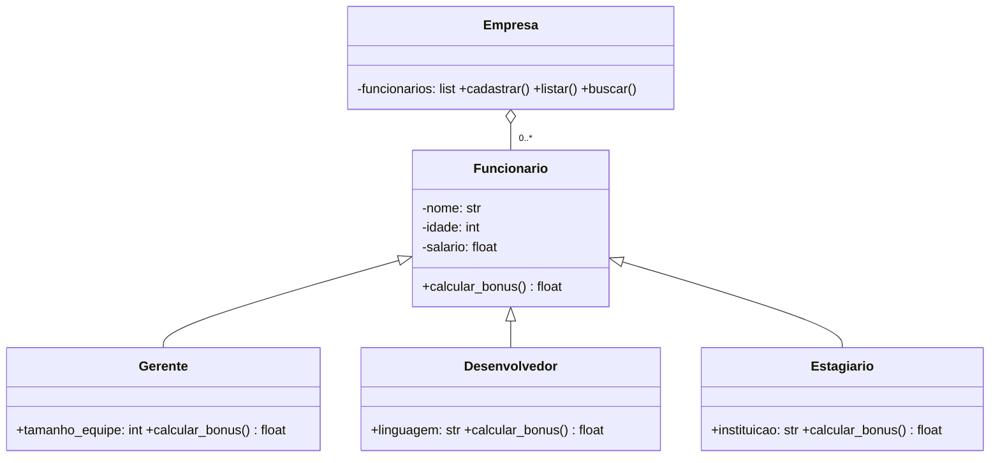

# Sistema de RH da Empresa Exemplo

**Tema:** Empresa (RH) | **Linguagem:** Python 3.10+ | **Interface:** terminal

## Integrantes

- [Preencher nomes do grupo, turma e avaliador]

## Problema e solução

A empresa precisa organizar dados básicos dos funcionários e consultar informações por nome ou cargo. Este protótipo permite cadastrar gerentes, desenvolvedores e estagiários, listar a equipe, buscar registros e calcular o bônus de cada função. Os dados ficam em memória durante a execução.

## Classes

- `Funcionario` é a classe base: valida nome, idade e salário; expõe os dados por propriedades; declara `calcular_bonus()` e formata os dados.
- `Gerente`, `Desenvolvedor` e `Estagiario` herdam de `Funcionario`, chamam `super().__init__()`, adicionam um atributo próprio e sobrescrevem `calcular_bonus()`.
- `Empresa` gerencia a lista de funcionários, cadastro, listagem e busca.
- `main.py` contém o menu interativo e a entrada/saída do terminal.

## Diagrama de classes



## Como executar

1. Instale Python 3.10 ou superior.
2. Abra esta pasta no PyCharm ou terminal.
3. Execute `python main.py`.
4. Use as opções do menu; os cadastros são mantidos enquanto o programa estiver aberto.

Não são necessárias bibliotecas externas.

## Estrutura

```text
funcionario.py   Classe base e validação
funcionarios.py  Gerente, Desenvolvedor e Estagiario
empresa.py       Classe gerenciadora da equipe
main.py          Menu interativo
.gitignore       Exclusões para Python e PyCharm
```

## Conceitos de POO demonstrados

- **Encapsulamento:** atributos privados em `Funcionario`, acessados por propriedades com validação.
- **Herança:** subclasses chamam `super().__init__()`.
- **Polimorfismo:** `calcular_bonus()` varia por cargo e é chamado no mesmo laço para objetos diferentes.
- **Composição:** `Empresa` mantém uma coleção de objetos `Funcionario`.

## Git e GitHub

Crie um repositório público com o padrão indicado pelo professor, por exemplo `poo-grupoX-empresa-rh`, na branch `main`. Adicione os integrantes como colaboradores. Cada integrante deve clonar o repositório, fazer suas próprias alterações e commits com mensagens descritivas; o histórico individual deve refletir o trabalho de cada pessoa. Sincronizem com `git pull` antes de começar e `git push` após os commits.

```bash
git init -b main
git add .
git commit -m "Cria sistema de RH da empresa"
git remote add origin URL_DO_REPOSITORIO
git push -u origin main
```

Configure o PyCharm para usar o interpretador Python local. O `.gitignore` exclui `.idea/`, ambientes virtuais e `__pycache__/`.

## Roteiro dos slides

1. Capa: nome do sistema, tema, integrantes e link do repositório.
2. Contexto: organização de cadastros e consulta de dados da equipe.
3. Diagrama com Funcionario, subclasses e Empresa.
4. Encapsulamento: propriedades de nome, idade e salário com validação.
5. Herança: uma subclasse usando `super().__init__()`.
6. Polimorfismo: cálculo de bônus para cada cargo.
7. Git/GitHub: captura real do repositório e contribuições do grupo.
8. Demonstração do menu no PyCharm.
9. Dificuldades encontradas e aprendizados reais do grupo.

A apresentação está em `apresentacao.html`. Abra no navegador e use as setas para navegar; escolha **Imprimir / salvar em PDF** para exportar. Antes de entregar, preencham os integrantes, turma, link do repositório e aprendizados reais. O histórico do GitHub, os commits individuais, as capturas e a apresentação oral precisam ser produzidos pelo grupo.
